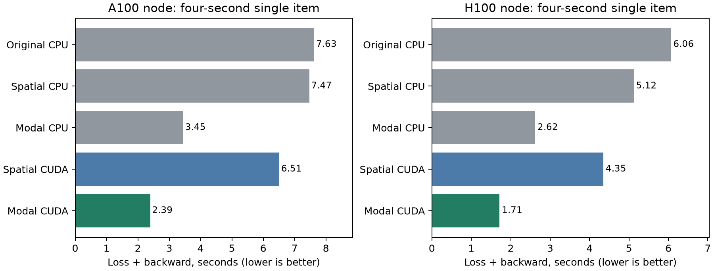

# GPU implementation measurements

Measured on 27 October 2026 through `hpc_sonic`. CUDA modal wins single-item
evaluation on the matched A100/H100 benchmark nodes. The newer `xhg1` node
(H200 NVL) has a sufficiently fast CPU that modal CPU wins the full Adam fit.
Use CPU modal for single-item synthesis without gradients; benchmark both modal
backends for fitting on each machine. Backend selection remains explicit.

## Four-second loss and backward evaluation

Default perceptual grid: 176 intervals, 132,300 Hz internal rate, 44,100 Hz output,
multimode excitation, float64, existing full-band CeL loss and all material
sensitivities. Each entry is the median of five warmed, synchronised evaluations,
including filtering, loss and backward. CPU uses one thread on the same node as
its corresponding GPU. Compilation/warmup is excluded and recorded separately.

| Backend | A100 node (s) | H100 node (s) |
|---|---:|---:|
| Original CPU | 7.627 | 6.064 |
| Spatial CPU | 7.470 | 5.119 |
| Modal CPU | 3.447 | 2.618 |
| Spatial CUDA | 6.512 | 4.348 |
| Modal CUDA | 2.392 | 1.714 |

Modal CUDA is 3.19× faster than original CPU on the A100 node and 3.54× on the H100
node. Against the newly improved modal CPU backend, the gains are 1.44× and 1.53×.
These are evaluation timings; complete optimiser runs are reported separately
below. They do not compare cluster GPUs with the older M4 Max measurements.

For pure synthesis, the new one-column CPU modal path takes 0.204 s (A100 node)
and 0.133 s (H100 node); CUDA modal takes 1.466 s and 1.178 s respectively. The
original CPU backend still computes tangents during synthesis. GPU acceleration
is therefore not a blanket win for every workload.

## Complete fitting runs on H200 NVL node `xhg1`

Both modal backends fit the identical original-CPU four-second target from the
same perturbed six-parameter start, with unchanged CeL, Adam/L-BFGS settings and
20-step convergence rule (500-step cap). Compilation and a full warmup evaluation
precede timing. CPU uses one thread. Both jobs completed successfully: 33556149
(CPU), 33556150 (CUDA). These are one complete run per optimiser/backend, not
five-run medians.

| Optimiser | Backend | Seconds | Steps | Evaluations | Best CeL |
|---|---|---:|---:|---:|---:|
| ADAM | [cpu modal](../benchmarks/gpu_results/recovery/cpu-modal-adam.json) | 211.7 | 122 | 123 | 3.8957919e-05 |
| ADAM | [cuda modal](../benchmarks/gpu_results/recovery/cuda-modal-adam.json) | 233.8 | 122 | 123 | 3.8956803e-05 |
| LBFGS | [cpu modal](../benchmarks/gpu_results/recovery/cpu-modal-lbfgs.json) | 291.8 | 53 | 171 | 3.3666624e-06 |
| LBFGS | [cuda modal](../benchmarks/gpu_results/recovery/cuda-modal-lbfgs.json) | 325.0 | 52 | 171 | 3.3666595e-06 |

On this machine, CPU modal is about 10% faster in wall time than
CUDA modal. Both recover essentially the same audio loss and parameters; small
roundoff differences can change individual L-BFGS line-search decisions. The
matched A100/H100 results above therefore should not be extrapolated to every
CPU/GPU pairing. The low audio loss also does not imply exact parameter recovery:
for example, B and radius retain appreciable errors on both backends. Raw results
include every history row and parameter error.

## Batch throughput

The internal same-grid interface measures 0.25-second strings with all eight
sensitivities, including initialization and output storage. This is simulator
throughput, not batched loss or optimiser throughput.

| Batch | A100 items/s | H100 items/s |
|---:|---:|---:|
| 1 | 6.6 | 9.2 |
| 2 | 13.0 | 18.2 |
| 4 | 26.0 | 36.4 |
| 8 | 51.9 | 72.7 |
| 16 | 103.9 | 145.4 |
| 32 | 207.7 | 291.0 |
| 64 | 415.5 | 582.0 |

A block owns each string. At these batch sizes, independent strings occupy more
GPU multiprocessors without substantially increasing elapsed time. Batch 64 uses
about 293 MB of allocated CUDA memory in this benchmark process. Longer audio and
larger batches increase tangent storage proportionally.

Adding the batch kernel now was worthwhile and is complete. A public fitting API
should follow only when its semantics are specified: per-item parameter bounds,
loss normalization, active/frozen controls and independent stopping. Adam can use
vectorised parameters, but independent L-BFGS line searches require additional
scheduling. The current public optimisers continue to fit one item.

## Why this kernel wins

The full discrete sine transform diagonalises linear spatial operators while
retaining every mode. The default modal CUDA kernel assigns one warp to each of
the nine value/sensitivity columns. It uses 288 threads, 88,560 bytes of shared
memory, and no thread-local spills (72 registers/thread on A100, 56 on H100).
The spatial variant uses 255 registers and spills to local memory, and has more
synchronisation overhead. The A100 profiler attributes approximately 98.7% of
CUDA time to the modal recurrence, so accelerating the loss alone would have
little effect on this workload. See the [profile table](../benchmarks/gpu_results/a100-modal-profile.txt).

## Validation and provenance

The accelerated suite checks all excitation types, multiple grids, both coordinate
systems, waveform/tangent agreement, finite differences, arbitrary scalar-loss
backward, chunk and stride boundaries, zero steps, primal-only execution, batch
isolation, full-state energy, CUDA streams and global-memory fallback. It also
checks the explicit first-derivative-only contract and short Adam/L-BFGS fits.
Four-second modal waveform relative L2 errors against original CPU are 6.59e-10
(perceptual coordinates) and 1.84e-9 (material coordinates); spatial errors are
below 1.83e-12. Undamped energy checks pass the 1e-10 relative drift threshold.

Raw observations include source hashes, host/GPU identity, PyTorch versions,
Slurm IDs, individual repetitions and CUDA-event timings:

- [A100 matched run](../benchmarks/gpu_results/a100-matched.json), node `sbg5`, job 33552880.
- [H100 matched run](../benchmarks/gpu_results/h100-matched.json), node `xdg1`, job 33550860.
- [A100 validation](../benchmarks/gpu_results/a100-validation.json) and [H100 validation](../benchmarks/gpu_results/h100-validation.json).

The matched runs used the final numerical kernels. A later Python cache fix adds
CUDA event waits and allocator stream tracking for safe first-use across streams;
it does not alter the recurrence. The A100 validation includes that fix and its
cross-stream regression. The [final A100 GPU refresh](../benchmarks/gpu_results/a100-final-gpu.json)
uses the same source hash as that validation; job 33552880 completed successfully. The H100 development worker completed its measurement
JSON, then exited with a shell parsing error after its running script was edited;
that worker is not represented as an entirely successful acceptance job.

Rebuild tables and the figure with `python benchmarks/summarize_gpu.py`.

The original CPU parameter/grid, synthesis, optimisation and numerical tests
passed in job 33550646. Fresh execution in job 33557437 passed both entry
notebooks, including GPU fitting and plots, and the independent compiled-dual /
checkpointed-reverse reference checks (maximum observed gradient error 1.17e-12).
Generated notebook outputs were also checked for hidden widget callback errors.
That job's final Octave dependency installation failed on an incomplete cached
OpenMP package; all three Octave/reference tests then passed in job 33561079 using an isolated
scratch cache. The six `hpc_sonic` planner tests also passed.
